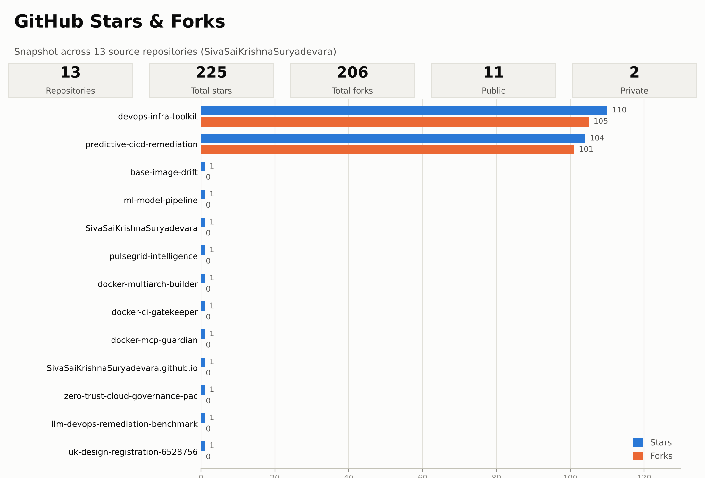

# Hi, I'm Siva Sai Krishna Suryadevara

**Senior Cloud Platform & DevOps Architect @ Evinova (AstraZeneca) · IEEE Senior Member**

I build guardrails for AI in software delivery: sandboxed runtimes that let LLM agents touch
infrastructure safely, CI/CD pipelines that diagnose and repair their own failures, and
policy-as-code that keeps regulated cloud environments compliant.

## Featured work

| Repository | What it does |
| --- | --- |
| [docker-mcp-guardian](https://github.com/SivaSaiKrishnaSuryadevara/docker-mcp-guardian) | MCP server that gives Claude and other agents read-mostly access to Docker: read-only by default, deny-listed restarts resolved by canonical name, secrets redacted. 47 tests. |
| [docker-ci-gatekeeper](https://github.com/SivaSaiKrishnaSuryadevara/docker-ci-gatekeeper) | Self-healing Docker CI step: parses BuildKit failures into a typed taxonomy, asks Claude Code for a minimal fix, verifies it with a rebuild. Hard cap of 2 attempts; fixes are staged, never applied blind. |
| [docker-multiarch-builder](https://github.com/SivaSaiKrishnaSuryadevara/docker-multiarch-builder) | Benchmark of QEMU emulation vs native Buildx nodes for multi-arch images. Measured: emulated arm64 builds ran ~16x slower; emulated amd64 on ARM crashed or hung in 5 of 5 runs. Raw data included. |
| [predictive-cicd-remediation](https://github.com/SivaSaiKrishnaSuryadevara/predictive-cicd-remediation) | Prototype of the system in my Indian patent application 202641038921: LLM-based prediction and automated remediation of CI/CD failures. |
| [zero-trust-cloud-governance-pac](https://github.com/SivaSaiKrishnaSuryadevara/zero-trust-cloud-governance-pac) | Reference policy-as-code architecture: OPA and AWS CDK rules for HIPAA, FINRA and GxP controls. |
| [llm-devops-remediation-benchmark](https://github.com/SivaSaiKrishnaSuryadevara/llm-devops-remediation-benchmark) | Sanitized CI/CD failure-log dataset and evaluation harness for LLM-driven remediation. |

Supporting repos: [ml-model-pipeline](https://github.com/SivaSaiKrishnaSuryadevara/ml-model-pipeline) (non-LLM failure classifier) ·
[devops-infra-toolkit](https://github.com/SivaSaiKrishnaSuryadevara/devops-infra-toolkit) (Compose, Kubernetes and Terraform for the reference workload)

## GitHub stats

<picture>
    <source media="(prefers-color-scheme: dark)" srcset="assets/github-dashboard-dark.png">
    
</picture>

<picture>
    <source media="(prefers-color-scheme: dark)" srcset="https://github-readme-stats.vercel.app/api?username=SivaSaiKrishnaSuryadevara&show_icons=true&theme=dark&disable_animations=true">
    
</picture>
<picture>
  <source media="(prefers-color-scheme: dark)" srcset="https://github-readme-stats.vercel.app/api/top-langs/?username=SivaSaiKrishnaSuryadevara&layout=compact&theme=dark&disable_animations=true">
  
</picture>

## Intellectual property

- **Indian patent application 202641038921** (sole inventor), *A System and Method for Predictive CI/CD
  Failure Prevention and Automated Remediation Using Large-Language Models*. Filed 29 Mar 2026,
  published 10 Apr 2026.
- **UK Registered Design 6528756** (co-proprietor), desk-mounted computer display unit for pipeline
  and sales data. Registered 24 May 2026.

## Research

IEEE Senior Member · author of 4+ IEEE Xplore publications on distributed cloud architectures ·
peer reviewer for Elsevier and Springer journals.

## Links

[Website](https://sivasaikrishnasuryadevara.github.io/) ·
[Repo stats dashboard](https://sivasaikrishnasuryadevara.github.io/github-dashboard.html) ·
[Google Scholar](https://scholar.google.com/citations?user=8uy_LdgAAAAJ&hl=en) ·
[LinkedIn](https://linkedin.com/in/sivasaikrishnasuryadevara)
